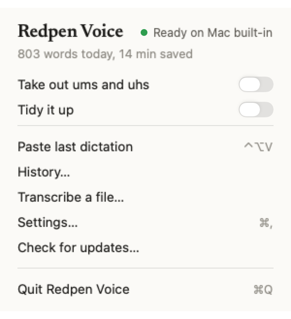
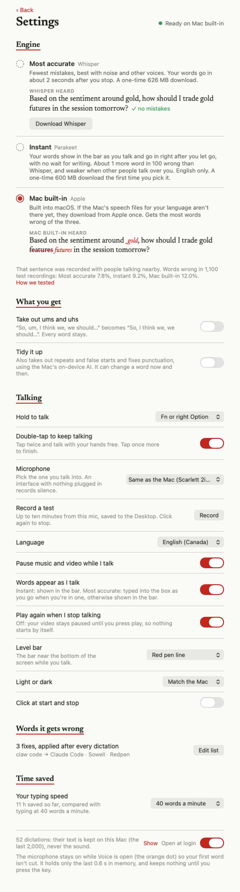
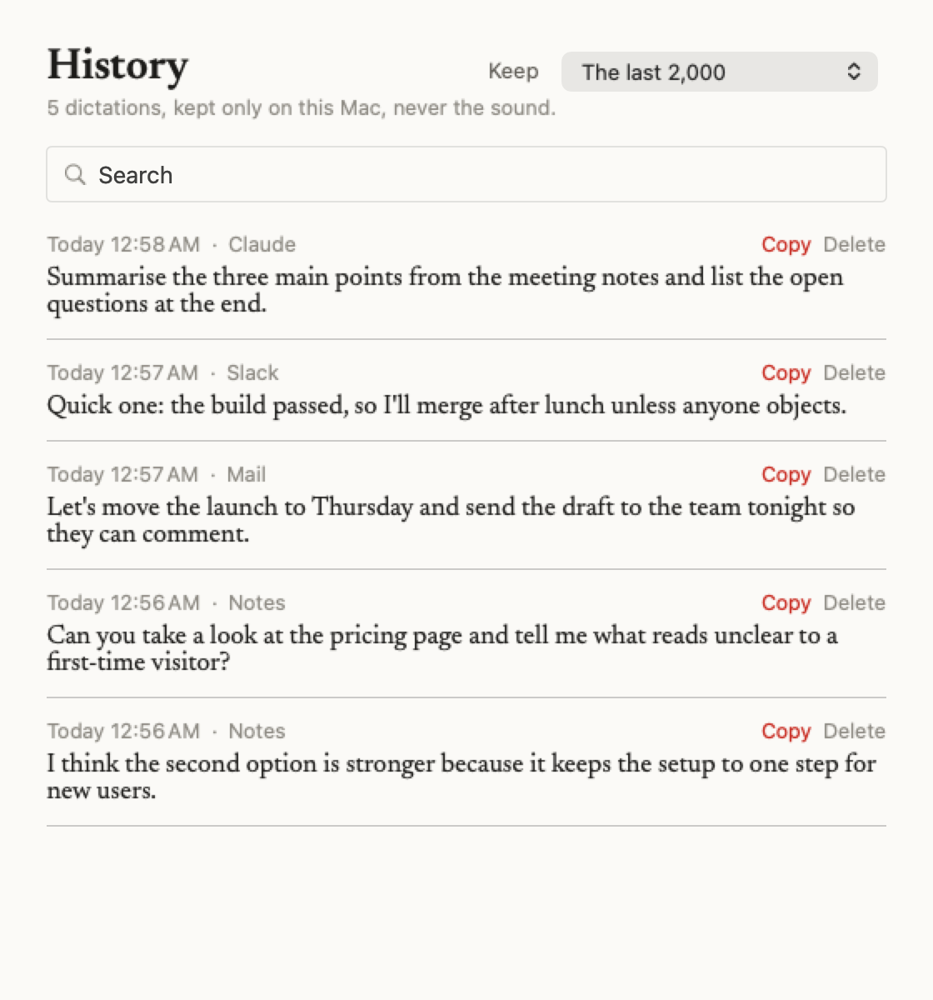
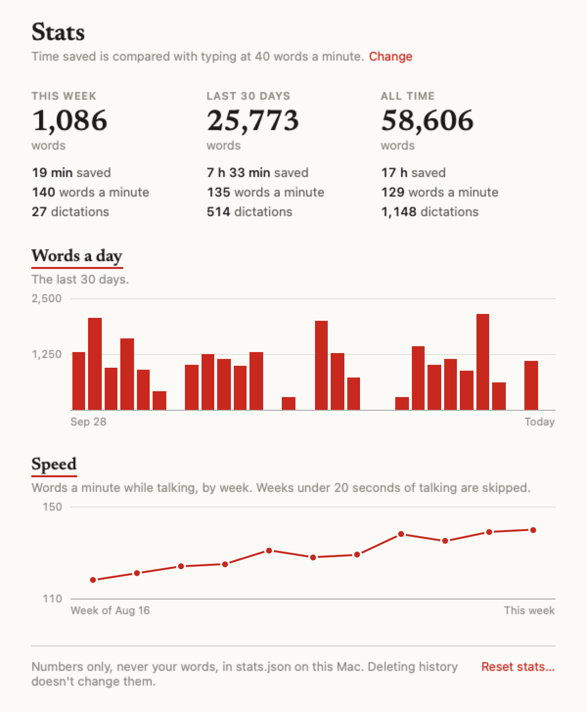

# Redpen Voice for Mac

A free, private dictation app for macOS, from the Redpen family of writing tools. Hold a key, talk, let go, and your words land where the cursor is, in almost any app.

Everything runs on your Mac. Your voice is never sent anywhere.

**[Download Redpen Voice for Mac](https://github.com/cjaynewton/redpen-voice-mac/releases/latest)** (free, macOS 26, Apple silicon)

<p align="center">
  
</p>

## How it works

1. **Hold Fn or right Option and talk.** A small bar at the bottom of the screen moves with your voice, so you know it's listening. With the Instant engine, your words show in it as you talk.
2. **Let go.** The words are typed into the box you were in, in any app, without touching your clipboard. If Voice can't see them arrive, the bar says so and Control-Option-V pastes them.

   

3. **Moved somewhere else while it wrote?** Before typing, Voice checks it's the same box you started in. If it can't be sure, it types nothing: the words wait until you're back in that box, and Control-Option-V pastes them anywhere.

   

Tap the key twice to keep talking with your hands free, and tap once more to finish.

### Pick the bar you like

<table>
<tr>
<td valign="top"><br><b>Red pen line</b><br>A pen line that moves with your voice, and the time.</td>
<td valign="top"><br><b>Rolling tape</b><br>Your voice scrolling past, with a recording dot.</td>
</tr>
<tr>
<td valign="top"><br><b>Bars from the middle</b><br>Bars that grow from the centre.</td>
<td valign="top"><br><b>Classic bars</b><br>A level meter, like a recorder.</td>
</tr>
<tr>
<td valign="top"><br><b>Breathing dot</b><br>Just a dot that breathes, and the time.</td>
<td valign="top">Or turn the bar off in Settings.</td>
</tr>
</table>

## What it does

- **Any key you like.** Fn, right Option, or a key you pick in Settings.
- **Words appear as you talk.** With Instant, your words show in the bar while you talk and go into the box right after you let go. With Whisper, each stretch is written at your next pause, so a one-minute dictation lands about 2 seconds after you stop; in a text box the words are typed as you go.
- **Your words, as said.** By default nothing is rewritten. Two switches change that:
  - **Take out ums and uhs** removes only the sounds. Every word stays.
  - **Tidy it up** also takes out repeats and false starts and fixes punctuation, using Apple's on-device model. It can change a word now and then.
- **Three engines, named for what they do.**
  - **Most accurate** is Whisper, OpenAI's model: the fewest mistakes, words about 2 seconds after you stop, a one-time 626 MB download.
  - **Instant** is Parakeet Unified, NVIDIA's model: it writes while you talk, so there's no wait for writing (about 0.05 seconds), with about 1 more word in 100 wrong than Whisper. English only, a one-time 600 MB download.
  - **Mac built-in** is Apple's engine, built into macOS (if the speech files for your language aren't on the Mac yet, they download from Apple once), with the most mistakes of the three.
- **Words it gets wrong.** A plain list, one per line: `claw code = Claude Code` fixes what it hears, a single name tells it to listen for that name.
- **Learns your names.** Fix a name by hand after a dictation ("so well" to "Sowell") and the second time you make the same fix, it goes into your list. Only names and terms are learned, never everyday words, and the list stays a plain file you can edit.
- **Learns how you talk.** Like a driving app that learns how you drive, it learns your pace and how long you pause, and uses that to decide where a thought ends. Only the numbers are kept.
- **Goes back to the box you started in.** If you move to another app or box while the words are being written, Voice only types into the box you started in, after checking it's the same box: same place, and its text still starting the way it did. When that app allows it they go straight in; otherwise they wait until you're back in that box. If that box was sent or changed meanwhile, or Voice can't tell, nothing is typed and Paste last has the words. If you started on a web page or a video instead of a text box, nothing is typed there (on a video page, letters are shortcuts): the words wait for you to click into a box.
- **Fits the sentence.** Dictate into the middle of a sentence and the first word starts lowercase ("and then and we go"), except "I" and names from your list; right before a word, the closing full stop goes. Only in boxes that tell Voice what's around the cursor.
- **Nothing lost.** Press Control-Option-V to paste your last dictation anywhere; it pastes (rather than types) so it works where typing just failed, and puts your clipboard back after. Every dictation is in the History window, unless you choose to keep nothing.
- **Take it back.** Control-Option-Z removes the last dictation, only when it is still the last thing typed.
- **Pauses your music and video** while you talk and starts them again after, only when something is actually playing.
- **Transcribe a file.** Any audio or video file to text, saved beside the file.

## The menu

Click the Voice icon in the menu bar for today's words, your speed and the minutes they saved you, with an all-time line under them; the two switches; Paste last dictation, History, Stats, Transcribe a file, Settings and Check for updates.

<p align="center">
<picture>
  <source media="(prefers-color-scheme: dark)" srcset="docs/screenshots/menu-dark.png">
  
</picture>
</p>

## Settings

Every choice on one page: the engine, how your words come out, the key you talk with, your microphone, the bar, your list of words it gets wrong, and your typing speed for time saved. Each engine shows a real sentence it heard, so you can judge before you download.

<p align="center">
<picture>
  <source media="(prefers-color-scheme: dark)" srcset="docs/screenshots/settings-dark.png">
  
</picture>
</p>

## The first time you open it

One window, three parts, and Done waits until each one works:

1. **How your words come out:** raw, ums taken out, or tidied.
2. **Set up:** the microphone, with its name and a live level so a silent or wrong mic shows now; Accessibility, so it can type into other apps and see your talk key; the speech engine, ready before you start; and, if you talk with Fn, the Mac's own Fn setting, which has to be off (or switch to right Option).
3. **Try it:** say one sentence into the window and see your own words before you leave.

macOS also asks for:

- **Speech Recognition**, when the app first opens, for Apple's own engine.
- **System audio**, the first time a video or song is playing when you start talking, so Voice can tell it's playing and take its words off the start of your dictation.

<p align="center">
<picture>
  <source media="(prefers-color-scheme: dark)" srcset="docs/screenshots/firstrun-dark.png">
  
</picture>
</p>

## History

Every dictation, newest first: search them, copy one, delete one. Choose how long they're kept: the last 2,000, the last week, or nothing at all. Open it from the menu.

<p align="center">
<picture>
  <source media="(prefers-color-scheme: dark)" srcset="docs/screenshots/history-dark.png">
  
</picture>
</p>

## Stats

This week, the last 30 days and all time: words, minutes saved, your average speed and how many dictations. Below them, your words a day for the last 30 days and your speed over time. Minutes saved are compared with typing at 40 words a minute; set your own typing speed in Settings. Open it from the menu. Stats are numbers only and stay when the history is cleared; Reset stats sets them back to zero.

<p align="center">
<picture>
  <source media="(prefers-color-scheme: dark)" srcset="docs/screenshots/stats-dark.png">
  
</picture>
</p>

## How accurate is it

All three engines were run on [WildSpeech-Bench](https://huggingface.co/datasets/tencent/WildSpeech-Bench), 1,100 public recordings of people asking questions: some in quiet rooms, some on the street, some with others talking.

| Engine | Words wrong | Engine's part after the audio ends |
|---|---|---|
| Most accurate (Whisper) | 7.8% | about 2 s |
| Instant (Parakeet Unified) | 9.2% | about 0.05 s |
| Mac built-in | 12.0% | |

The Instant figure is the model fed in pieces as a microphone would, the way the app runs it. The last column is only the engine's part, measured on an M1 Max. On top of it, Voice keeps listening 0.1 seconds after you let go (0.5 seconds if you were still talking) and then types the words: across 19 real dictations that part took a median 0.58 seconds (0.17 seconds when you'd already stopped talking). So with Instant, words land about 0.6 seconds after you let go.

### FluidVoice's engines, on the same recordings

[FluidVoice](https://github.com/altic-dev/FluidVoice) is another free, on-device dictation app for Mac. Its default engine on Apple silicon is Parakeet TDT v3, run on the whole recording when you let go; Flash (Parakeet EOU) is one of its options. We ran both through [FluidAudio](https://github.com/FluidInference/FluidAudio), the open library it builds on, the way FluidVoice runs them, on an M1 Max.

| Engine | Words wrong, WildSpeech (275 recordings) | Words wrong, one-minute dictations (30) | Engine's part after the audio ends | Peak memory |
|---|---|---|---|---|
| Most accurate (Whisper), Redpen Voice | 7.8% | 3.5% | about 1.2 s for the last stretch | |
| Instant (Parakeet Unified), Redpen Voice | 9.9% | 3.4% | 0.03 s at any length | 51 MB |
| Parakeet TDT v3, FluidVoice's default | 10.3% | 5.3% | 0.12 s for a short dictation, 0.73 s for a minute | 104 MB |
| Flash (Parakeet EOU), a FluidVoice option | 22.1% | not run | 0.02 s | |

How it was tested: the WildSpeech column is every fourth recording of the 1,100 (Whisper scores 7.8% on these and on all of them), scored with the same text normalizer as the table above. The one-minute dictations are 30 LibriSpeech recordings of read speech, about a minute each. Times are the engine's work after the last of the audio, not the whole wait after you let go. These are the engines, not the apps: FluidVoice uses its own build of FluidAudio, and for recordings over 15 seconds its own way of splitting them, which we didn't reproduce. Peak memory is the test program's, measured by macOS; Whisper's is left blank because it was only measured inside the whole app (about 220 MB).

On [TORGO](https://www.cs.toronto.edu/~complingweb/data/TORGO/torgo.html), recordings of slurred speech from people with dysarthria, Whisper got 32.2% of words wrong and the built-in engine 39.4%. On the clear speech in the same set, 2.2% and 7.7%.

## Privacy

- Speech is turned into text on your Mac, by every engine. Nothing you say or write is sent anywhere.
- **What is kept, and where.** All in `~/Library/Application Support/Redpen Voice/`, readable only by your account on this Mac:
  - `history.jsonl`: the text of your last 2,000 dictations (what was heard and, if you use a tidy option, what went in), with when, how long and which app. Never the sound. This is what Paste last reads. You can delete it any time.
  - `stats.json`: numbers only, never your words. For each day and engine: how many words, how many seconds of talking, and how many dictations. Kept whatever you choose for the history; Reset stats in the Stats window clears it.
  - Your word list (a plain text file), `talk.json` (your pace and pauses, numbers only) and `learned.json` (counts of the name fixes it has seen, stored as fingerprints, not words).
  - The log in `~/Library/Logs/RedpenVoice.log` holds timings, app names and counts, never your words.
- **The microphone stays on while Voice is open**, so the Mac's orange microphone dot stays lit. It holds only the last 0.6 seconds in memory, so the word you say as the key goes down isn't cut, and that is overwritten continuously. Nothing is kept until you press the key.
- **Text boxes.** It reads the box you're dictating into, on your Mac: when you start (so the words go back to the right box) and after (to learn the names you fix). Only the fixed names are kept.
- **Clipboard.** Voice types your words; it only borrows the clipboard for Paste last. The text is marked so clipboard managers skip it, and what you had is put back half a second later, unless you copied something new in between. A second Paste last within 1.5 seconds waits, so an app that's slow to paste doesn't get it twice; an app frozen for longer than that is the one case this can't rule out.
- **How long dictations are kept** is your choice in the History window: the last 2,000, the last week, or nothing (Paste last then works until Voice quits).
- **Videos.** When it pauses a video, it listens to that app's sound for about a second, in memory only, to take the video's words off the start of your dictation.
- **Network.** The Whisper or Instant model downloads once from Hugging Face if you choose one; Apple's speech files for your language download once from Apple if the Mac doesn't have them yet; and the app checks GitHub once a day for a newer version.

## Install

Download `Redpen-Voice-0.11.dmg` from the [latest release](https://github.com/cjaynewton/redpen-voice-mac/releases/latest), open it and drag Redpen Voice to Applications. It needs macOS 26 on a Mac with Apple silicon, and updates itself.

First run asks for the microphone and Accessibility (to type into other apps and see the Fn key); macOS also asks for Speech Recognition, and for system audio the first time a video is playing when you talk. If you talk with Fn, set "Press 🌐 key to" to Do Nothing in Keyboard settings, or the Mac also opens its own dictation or the emoji picker.

### Build from source

Needs macOS 26 and Xcode (free from the Mac App Store; open it once before building).

```sh
git clone https://github.com/cjaynewton/redpen-voice-mac.git
cd redpen-voice-mac
./build.sh
```

This builds `Redpen Voice.app` and installs it to `~/Applications`. On first launch it asks for the microphone and Accessibility (needed to type into other apps and to see the Fn key).

To keep Accessibility permission across rebuilds, sign with your own certificate: create a `.local.env` beside `build.sh` with `REDPEN_SIGN_ID="Apple Development"`.

## Checks

```sh
swift run redpen-voice-test
```

Runs the checks for the parts that need no microphone: the word list, history, stats, the ums filter, silence handling, the media pause, where a recording is cut while you talk, how-you-talk numbers, learning fixed names and screen hints.

`"Redpen Voice.app/Contents/MacOS/RedpenVoice" --stream-test files.txt out.jsonl` writes each audio file whole and streamed, with the wait after release, for checking streaming against long recordings.

## Credits

- [Whisper](https://github.com/openai/whisper) by OpenAI (MIT), the Most accurate engine's model.
- [WhisperKit](https://github.com/argmaxinc/argmax-oss-swift) by Argmax runs Whisper on the Mac.
- [FluidAudio](https://github.com/FluidInference/FluidAudio) by Fluid Inference (Apache 2.0) runs Parakeet on the Mac.
- [Parakeet Unified 0.6B](https://huggingface.co/nvidia/parakeet-unified-en-0.6b) by NVIDIA, the Instant engine's model, under [CC BY 4.0](https://creativecommons.org/licenses/by/4.0/), converted for the Mac by [Fluid Inference](https://huggingface.co/FluidInference/parakeet-unified-en-0.6b-coreml).
- [Newsreader](https://fonts.google.com/specimen/Newsreader) by Production Type, under the SIL Open Font License 1.1.
- Sibling app: [Redpen Grammar for Mac](https://github.com/cjaynewton/redpen-grammar-mac).

## License

MIT. See [LICENSE](LICENSE).
